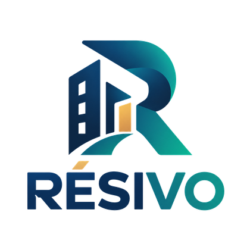
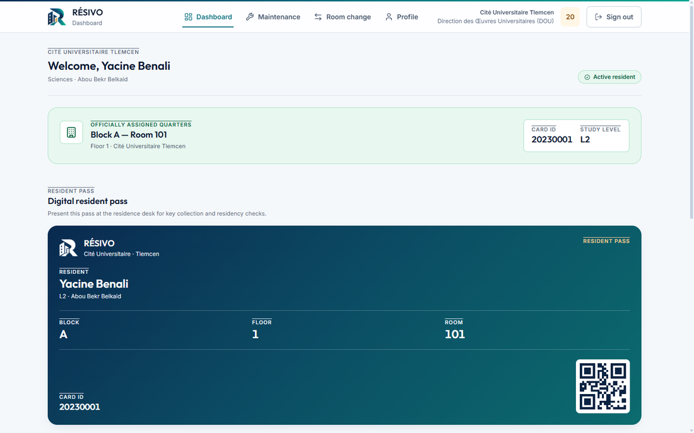
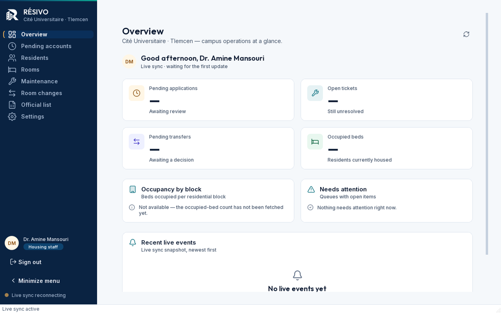
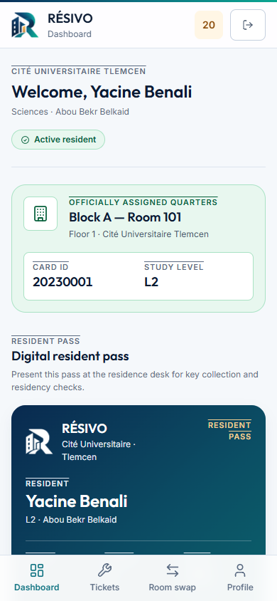

<h1 align="center">Hallo! 👋 Ich bin Sebai Anes</h1>

  <strong>Ich suche eine Ausbildung als <code>Fachinformatiker/in</code> in Deutschland.</strong> 
  <em>I am looking for an apprenticeship as a Fachinformatiker (IT specialist) in Germany.</em>

  <b>Anwendungsentwicklung</b> &nbsp;·&nbsp; <b>Systemintegration</b> &nbsp;·&nbsp; <b>Daten- und Prozessanalyse</b>

  
  
  
  
  
  

---

## 📌 Kurzvorstellung / About

| 🇩🇪 Deutsch | 🇬🇧 English |
|---|---|
| Ich bin **Technicien Supérieur** in Informatik aus Algerien. Ich entwickle Software mit **Python**, **TypeScript** und **Flutter**. Ich mag Datenbanken und gute Benutzeroberflächen. Ich möchte meine Kenntnisse in Deutschland vertiefen. | I am a **Technicien Supérieur** in computer science from Algeria. I build software with **Python**, **TypeScript** and **Flutter**. I care about databases and clean user interfaces. I want to deepen my skills in Germany. |

<em>⬇️ Mein wichtigstes Projekt / My main project ⬇️</em>

---

## 🏠 RÉSIVO — Studentenwohnheim-Verwaltung / University Residence Management

  <picture>
    <source media="(prefers-color-scheme: dark)" srcset="assets/resivo-logo-dark.png" />
    
  </picture>

  
  
  
  
  
  
  
  
  
  

| 🇩🇪 Deutsch | 🇬🇧 English |
|---|---|
| **RÉSIVO** ist ein System für die Verwaltung von Studentenwohnheimen. Ich habe es für die **Direction des Ouvres Universitaires** in Tlemcen (Algerien) entwickelt.  Es hat drei Teile: eine **Web-App für Studenten**, ein **Desktop-Programm für das Personal** und einen **MCP-Server für ChatGPT**.  Die Daten liegen in **PostgreSQL** mit RLS und Stored Procedures. Ich habe dazu auch meine **Abschlussarbeit** geschrieben. | **RÉSIVO** is a system for managing university student residences. I developed it for the **Direction des Ouvres Universitaires** in Tlemcen (Algeria).  It has three parts: a **web app for students**, a **desktop app for staff**, and an **MCP server for ChatGPT**.  The data lives in **PostgreSQL** with RLS and stored procedures. I also wrote my **final-year thesis** about it. |

### 📸 Oberfläche / Interface

<table>
  <tr>
    <td width="50%"> Web-Portal (Astro 5) / Web portal (Astro 5)</td>
    <td width="50%"> Personal-Konsole (PySide6) / Staff console (PySide6)</td>
  </tr>
</table>

   
  Responsive / Mobil

### 🎯 Passend zu den Fachrichtungen / Matches the specialisations

| Fachrichtung | Nachweis / Evidence |
|---|---|
| **Anwendungsentwicklung** Application development | Astro-5-Portal mit SSR und Tailwind CSS v4, PySide6-/Qt6-Desktop-Konsole, TypeScript, PL/pgSQL-Funktionen, eigene Design-Tokens (WCAG AA) und eine gemeinsame Komponentenbibliothek für Web und Desktop. |
| **Systemintegration** Systems integration | Supabase Auth, Storage und Edge Functions; MCP-Server auf Cloudflare Workers; Live-Sync-Worker mit 2-Sekunden-Polling; Integration von Web, Desktop und KI über eine gemeinsame Datenbank; Hintergrund-Worker mit Threading und sauberem Shutdown. |
| **Daten- und Prozessanalyse** Data & process analysis | PostgreSQL mit RLS-Policies und `SECURITY DEFINER`-Funktionen, Workflow *Anfrage → Prüfung → Genehmigung*, Wartungsprozess *Offen → In Arbeit → Erledigt*, Import und Validierung des offiziellen Prüfungsregisters (CSV/Excel), KPI-Abfragen zu Auslastung und offenen Tickets in natürlicher Sprache. |

### 📊 Fakten / Facts

| 🇩🇪 Deutsch | 🇬🇧 English |
|---|---|
| **23 automatisierte Tests** (Pytest) und eine Vitest-Suite · **RLS-Policies** auf Datenbankebene · **Idempotente Migrationen** und transaktionale Stored Procedures · Pflichtbegründung bei jeder Ablehnung (Audit-Trail für Rückfragen am Schalter) · Schutz gegen Selbstlöschung von Personal-Konten auf UI-, Edge-Function- und Datenbankebene · Keine Secrets im Quellcode · MIT-Lizenz · Abschlussarbeit (Mémoire de fin d'études) | **23 automated tests** (Pytest) plus a Vitest suite · **RLS policies** at the database level · **Idempotent migrations** and transactional stored procedures · Mandatory reason for every rejection (audit trail for desk enquiries) · Protection against staff self-deletion at UI, Edge Function and database level · No secrets in the source code · MIT licence · Final-year thesis (Mémoire de fin d'études) |

---

## 💼 Weitere Projekte / Other Projects

| Projekt / Project | Beschreibung / Description | Fachrichtung |
|---|---|---|
| **Ulvic Console** — Ledger & Lager | Internes Verwaltungssystem für die Druckerei **Ulvik Print** (Algier): Umsatz, Kosten, Gewinn und Deckungsbeitrag als KPI-Panel, Lagerbestände in Echtzeit, Kalender-Ledger mit Notizen (Next.js, React, TypeScript, Supabase).  Internal ledger for the Ulvik Print workshop: revenue, expenses, profit and margin KPIs, real-time stock, calendar-based ledger. | Daten- und Prozessanalyse |
| **[Ulvik Print](https://github.com/anesdevv/ulvik-print)** — Onlineshop | Onlineshop für individuelle Textil-Drucke, gebaut für den algerischen Markt (Vite, React 19, TypeScript, Tailwind CSS v4, Supabase) mit Backoffice-Verwaltung.  Custom apparel e-commerce storefront with back-office management, built for the Algerian market. | Anwendungsentwicklung |
| **[FlowVoice](https://github.com/anesdevv/flow-voice)** — Sprachdiktat | Desktop-App für **lokale** Sprachdiktate (Electron, Python, Whisper offline). Kein Cloud, keine Accounts, kein Telemetrie — die Transkription läuft auf dem eigenen Rechner.  100% private local voice dictation with offline Whisper. No cloud, no accounts, no telemetry. | Anwendungsentwicklung · Systemintegration |
| **[Lycée Yaghmouracen](https://github.com/anesdevv/lycee-yaghmouracen)** — Schulverwaltung | Verwaltungssystem für eine weiterführende Schule (Python, PySide6/Qt6, SQLite) mit Schülern, Noten, Zeugnissen und Abschlüssen, getestet mit Pytest.  High-school management system with pupils, grades, transcripts and diplomas, tested with Pytest. | Daten- und Prozessanalyse |
| **[Anes Journey](https://github.com/anesdevv/anes-journey)** — Flutter-App | All-in-one-App für Gewohnheiten, Aufgaben und Tagesplanung (Dart, Flutter, Supabase).  All-in-one productivity app for habits, tasks and daily planning. | Anwendungsentwicklung |
| **[Employee Management System](https://github.com/anesdevv/employee-management-system)** — Mitarbeiterverwaltung | Mitarbeiterverwaltung mit CustomTkinter und SQLite, inklusive Dashboard, Rollen und zweisprachiger Oberfläche (Französisch/Englisch).  Employee management with CustomTkinter and SQLite, including a dashboard, roles and a bilingual interface. | Anwendungsentwicklung |
| **[Infinite XO](https://github.com/anesdevv/infinite-xo)** — Browser-Spiel | Tic-Tac-Toe mit FIFO-Mechanik: Jede Figur hat eine begrenzte Lebensdauer (TypeScript).  Tic-tac-toe reimagined with a FIFO mechanic — every mark has a half-life. | Anwendungsentwicklung |

  🔗 <a href="https://github.com/anesdevv?tab=repositories">Alle Repositories / All repositories</a> &nbsp;·&nbsp; <a href="https://learning-deutsch-with-anes.netlify.app/">Learn Deutsch With Anes</a> — meine eigene Deutschlern-App mit A1/A2-Texten, Vokabeln und Quiz / my own German-learning app with A1/A2 texts, vocabulary and quizzes

---

## 🛠️ Technologien / Tech Stack

  
  
  
  
  
  
  
  

  
  
  
  
  

  
  
  
  
  
  
  
  
  
  

---

## 🎓 Ausbildung, Sprache & Praxis / Education, Language & Experience

| | 🇩🇪 Deutsch | 🇬🇧 English |
|---|---|---|
| **Ausbildung** | Technicien Supérieur (Informatik), Algerien — Abschlussarbeit über RÉSIVO | Technicien Supérieur (computer science), Algeria — final-year thesis on RÉSIVO |
| **Praxis** | 6-monatiges Praktikum: Entwicklung einer Mitarbeiter-Datenbank (Gesundheitsdaten) für ein Unternehmen | 6-month internship: development of an employee database (occupational health data) for a company |
| **Projekte** | 11 öffentliche Repositories (Open Source) — Schwerpunkt: Web- und Desktop-Entwicklung, Datenbanken und Datenanalyse | 11 public repositories (open source) — focus: web and desktop development, databases and data analysis |
| **Deutsch** | **B1** — in Weiterbildung, Ziel **B2** vor dem Ausbildungsbeginn | **B1** — continuing study, target **B2** before the apprenticeship starts |
| **Englisch** | **B2** — Arbeitssprache in meinen Projekten | **B2** — working language in my projects |
| **Französisch** | **C1** | **C1** |
| **Ausbildungsstart** | **August 2027** | **August 2027** |
| **Standort** | **Bundesweit offen**, umzugsbereit | **Open to any region in Germany**, willing to relocate |

---

## 📫 Kontakt / Contact

| | |
|---|---|
| **E-Mail** | <a href="mailto:sebaianesmiloud@gmail.com">sebaianesmiloud@gmail.com</a> |
| **LinkedIn** | <a href="https://linkedin.com/in/anesmiloudsebai">linkedin.com/in/anesmiloudsebai</a> |
| **Portfolio** | <a href="https://anesdevv-portfolio.vercel.app/">anesdevv-portfolio.vercel.app</a> |
| **Lebenslauf** | <a href="Lebenslauf.pdf">Lebenslauf.pdf</a> (deutsch) · <a href="Lebenslauf.md">Lebenslauf.md</a> |
| **GitHub** | <a href="https://github.com/anesdevv">github.com/anesdevv</a> |

---

  
    Danke für Ihren Besuch! Ich freue mich auf Ihre Nachricht. 
    Thank you for visiting! I look forward to hearing from you.
  

